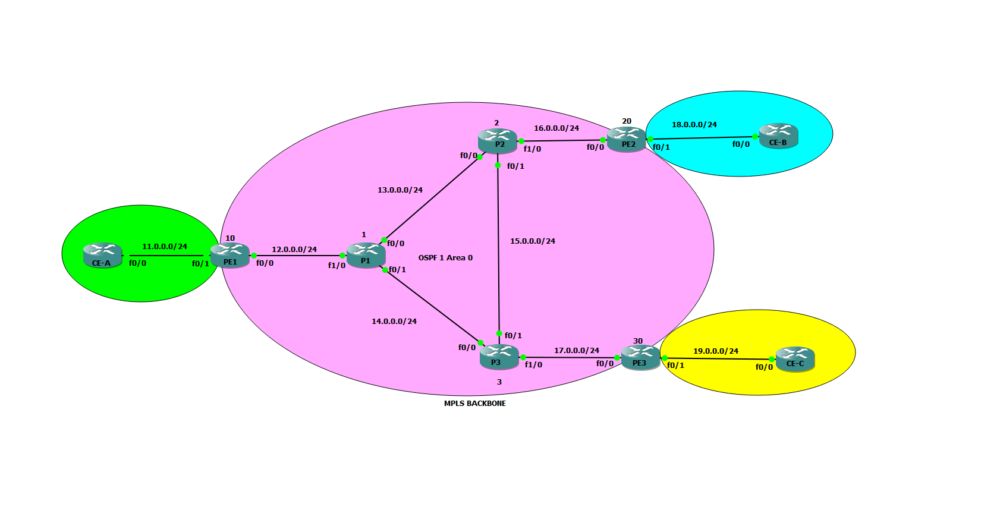

# Infrastructure réseau multi-sites MPLS (OSPF · LDP · MP-BGP)

Un projet universitaire sur **MPLS (Multi-Protocol Label Switching)** : étude complète de la technologie (VPN, ingénierie de trafic, QoS, tolérance aux pannes, sécurité, comparaison avec SD-WAN) et **mise en œuvre d'un backbone MPLS multi-sites** en laboratoire, avec échange de routes VPNv4 entre routeurs PE via MP-BGP.

> Faculté des Sciences et Techniques de Marrakech, Université Cadi Ayyad, année universitaire 2024-2025
> Encadrant : Pr. Yassine SADQI

## Sommaire

- [Objectifs](#objectifs)
- [Architecture](#architecture)
- [Ce qui a été réalisé en laboratoire](#ce-qui-a-été-réalisé-en-laboratoire)
- [Ce qui a été étudié (partie théorique)](#ce-qui-a-été-étudié-partie-théorique)
- [Configuration et vérification](#configuration-et-vérification)
- [Structure du dépôt](#structure-du-dépôt)
- [Pistes d'amélioration](#pistes-damélioration)
- [Équipe](#équipe)
- [Licence](#licence)

## Objectifs

- Comprendre le fonctionnement de MPLS : labels, LSR/LER, FEC, LSP, plans de contrôle et de données (FIB/LFIB).
- Déployer un cœur de réseau MPLS (routeurs P et PE) et valider la distribution de labels via LDP.
- Mettre en place MP-BGP entre les PE pour préparer le transport de VPN de niveau 3 entre sites clients.
- Analyser les enjeux de sécurité, de résilience et de qualité de service d'un réseau MPLS.

## Architecture



Le backbone est composé de **3 routeurs PE** (Provider Edge) et **3 routeurs P** (Provider), relié à **3 sites clients** (CE-A, CE-B, CE-C). Le cœur tourne en **OSPF processus 1, area 0** ; les PE échangent leurs routes via **MP-BGP (AS 1)**.

| Lien | Réseau |
|---|---|
| CE-A ↔ PE1 | 11.0.0.0/24 |
| PE1 ↔ P1 | 12.0.0.0/24 |
| P1 ↔ P2 | 13.0.0.0/24 |
| P1 ↔ P3 | 14.0.0.0/24 |
| P2 ↔ P3 | 15.0.0.0/24 |
| P2 ↔ PE2 | 16.0.0.0/24 |
| P3 ↔ PE3 | 17.0.0.0/24 |
| PE2 ↔ CE-B | 18.0.0.0/24 |
| PE3 ↔ CE-C | 19.0.0.0/24 |

Adresses de loopback utilisées pour les sessions iBGP : PE1 `10.10.10.10`, PE2 `20.20.20.20`, PE3 `30.30.30.30`.

## Ce qui a été réalisé en laboratoire

| Étape | Détail | Vérification |
|---|---|---|
| Adressage et IGP | Adressage des interfaces backbone, OSPF 1 area 0 sur PE1-3 et P1-3 | `show ip route ospf`, `ping` entre loopbacks |
| Distribution de labels | LDP activé via `mpls ldp autoconfig` sous OSPF sur les 6 routeurs | `show mpls interface`, `show mpls ldp neighbor` |
| MP-BGP | Sessions iBGP (AS 1) entre PE1, PE2, PE3 depuis les loopbacks, address-family `vpnv4` activée | `show bgp vpnv4 unicast all summary` |

## Ce qui a été étudié (partie théorique)

Le rapport (55 pages) couvre en plus les sujets suivants, présentés au niveau conceptuel :

- **MPLS VPN** : Pseudowire, VPLS, VPRN (L3VPN), VRF, Route Distinguisher, Route Target.
- **Ingénierie de trafic (TE)** : tunnels TE, headend/tail/midpoint, techniques de TE, **QoS** dans un réseau MPLS (champ EXP / DiffServ).
- **Tolérance aux pannes** : types de défaillances, détection (RSVP-TE Hello, graceful restart), stratégies de restauration (rerouting, protection 1+1 / 1:1, **Fast Reroute**).
- **Sécurité MPLS** : attaques sur les plans de contrôle et de données, moyens de défense (authentification LDP/BGP, **IPsec**, contrôle d'accès, isolation des interfaces de gestion).
- **MPLS vs SD-WAN** : avantages, limites, complémentarité.

> Ces mécanismes (IPsec, QoS, FRR) sont analysés dans le rapport mais **ne sont pas configurés dans le lab** décrit ci-dessus. Voir les [pistes d'amélioration](#pistes-damélioration).

## Configuration et vérification

Les extraits de configuration sont dans [`configs/`](configs/) :

- [`backbone-ospf-ldp.cfg`](configs/backbone-ospf-ldp.cfg) : OSPF + LDP sur le backbone et commandes de vérification.
- [`pe-mpbgp-vpnv4.cfg`](configs/pe-mpbgp-vpnv4.cfg) : MP-BGP VPNv4 entre PE.

Extrait MP-BGP (PE1) :

```
router bgp 1
 neighbor 20.20.20.20 remote-as 1
 neighbor 30.30.30.30 remote-as 1
 neighbor 20.20.20.20 update-source Loopback0
 neighbor 30.30.30.30 update-source Loopback0
 no auto-summary
 address-family vpnv4
  neighbor 20.20.20.20 activate
  neighbor 30.30.30.30 activate
```

Les captures des tables de routage, des voisins LDP et du résumé BGP sont dans le rapport (sections 13.2 à 13.5).

## Structure du dépôt

```
.
├── README.md
├── LICENSE
├── configs/
│   ├── backbone-ospf-ldp.cfg
│   └── pe-mpbgp-vpnv4.cfg
├── docs/
│   ├── MPLS_Rapport.pdf          # Rapport complet (55 pages)
│   └── MPLS_Presentation.pdf     # Support de présentation (36 slides)
└── images/
    └── topologie-backbone-mpls.png
```

## Pistes d'amélioration

Suites logiques pour compléter le lab et couvrir le volet « sécurisé » :

- Configurer les **VRF** (RD/RT) sur les PE et valider la connectivité CE-A ↔ CE-B ↔ CE-C.
- **Authentifier** les sessions LDP et BGP (MD5).
- Ajouter un **VPN IPsec** entre sites clients et vérifier son interaction avec le transport MPLS.
- Appliquer une politique **QoS** (marquage DSCP → EXP, files prioritaires) et mesurer son effet.
- Mettre en place **MPLS TE / Fast Reroute** et tester une coupure de lien.

## Équipe

- Imane ARRACH
- Salma BENDER

## Licence

Les fichiers de configuration sont publiés sous licence [MIT](LICENSE). Le rapport et la présentation (dossier `docs/`) restent la propriété de leurs auteurs.
